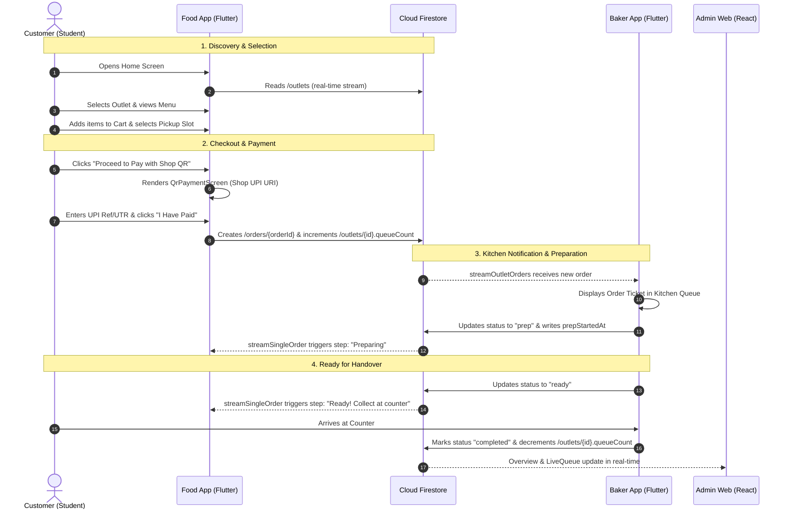
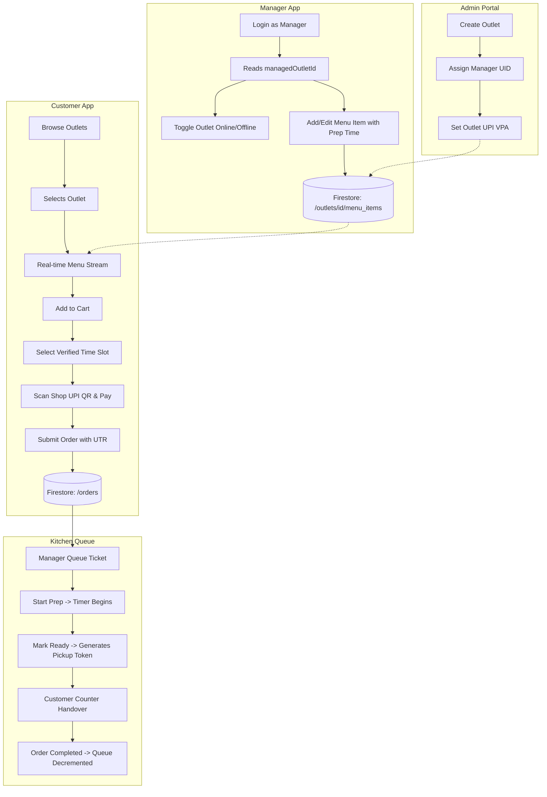

# 📋 AuraBake — Complete Application Audit, Feature Inventory & Development Readiness Report

**Document Version:** 1.0.0  
**Audit Date:** November 22, 2026  
**Auditor Roles:** Senior Full-Stack Architect, Flutter Developer, React Developer, Firebase Engineer, UI/UX Designer, QA Engineer  
**System Evaluated:** AuraBake Campus Food Pre-Ordering System  
**Repository Branch:** `main` (with cross-reference to `origin/master`)

---

## Executive Summary

AuraBake is an ambitious, domain-specific campus food pre-ordering and queue-reduction ecosystem composed of:
1. **A Flutter Mobile Application** (`client/food_app`) serving two distinct roles: **Customers (Students/Faculty)** and **Outlet Managers (Bakers/Staff)**.
2. **A React/Vite Admin Web Dashboard** (`client/admin_web`) serving the **Super Administrator**.
3. **A Firebase Serverless Backend** (`firebase/`) utilizing **Cloud Firestore**, **Firebase Authentication**, and Firestore Security Rules.

This comprehensive audit was conducted by inspecting the live codebase, schema definitions, authentication flows, security rules, network operations, and UI code across all three application roles.

### Summary Assessment
- **Overall Operational Health:** **Partially Functional with Severe Data Synchronization & Architectural Bottlenecks.**
- **Key Working Features:** Customer registration/login, initial outlet browsing, client-side cart calculation, shop UPI QR payment screen generation, manager queue status transitions (`pending` -> `prep` -> `ready` -> `completed`), Admin Web login, and basic Live Queue order monitoring.
- **Critical Architectural Flaws Uncovered:**
  1. **Menu Synchronization Breakdown:** `CustomerHome` queries the parent `/outlets` collection once and performs a `.get()` on subcollections. Because Firestore collection listeners do not emit events when subcollection documents (`/outlets/{outletId}/menu_items`) are added or edited, **new items created by managers never appear on the customer side without a hard app restart**. Furthermore, `MenuScreen` accepts a static `Outlet` object with no stream listener whatsoever.
  2. **Outlet Identity & Linking Gap:** Managers self-assign an unverified `managedOutletId` during registration or via dialog. If this string does not exactly match a seeded document ID (e.g. `o1` vs `"Nescafe"`), orders and menus decouple into orphaned documents.
  3. **Inert & Placeholder Admin Components:** In the Admin Web, the `+ Add Item` button has no `onClick` handler, `Analytics.tsx` is an empty placeholder, and outlet creation/assignment is completely absent.
  4. **Security Rules Blacklist / Deficit:** The Firestore security rules completely lack match blocks for `support_reports`, `time_slots`, `categories`, and `system_stats`. Customer support ticket submissions fail with permission denied.
  5. **Dual-QR Ambiguity:** The customer-facing Shop UPI Payment QR was recently wired, but the counter handover / pickup verification QR code (to verify that the correct student receives the order) is completely missing from both customer and staff screens.
  6. **Branch Divergence:** Branch `origin/master` contains advanced Cloud Functions (`placeOrder`, `onOrderUpdated`, `syncAuthUser`) and additional admin views (`SlotManager.tsx`, `UserDirectory.tsx`) in commit `97052f9` that were never merged into `main`.

---

# PART 1 — COMPLETE PROJECT UNDERSTANDING

### 1.1 Problem Statement
Campus cafeterias and dining kiosks suffer from severe order clustering during brief inter-class breaks (typically 10–15 minutes). Traditional on-site ordering leads to:
- Excessive physical queues (often 30+ students deep).
- Kitchen congestion, unpredictable preparation bursts, and food wastage.
- Missed meals for students with tight class schedules.
- Lost revenue for campus vendors who cannot service peak-hour volume efficiently.

### 1.2 Intended Business Model
AuraBake operates on a closed-loop campus marketplace model:
1. **Commission on Vendor Orders:** Micro-transaction platform fee or percentage per completed order.
2. **AuraBake Premium Subscription:** A student/faculty tier (configured at ₹99/month in `customer_home.dart` and `premium_screen.dart`) that grants:
   - Priority kitchen queue placement (orders tagged with `isPremium: true` to leapfrog regular queues).
   - 10% platform discount on orders.
   - Skip-the-line privileges and reduced estimated wait times (`avgWait / 2`).
3. **Vendor SaaS Fee:** Outlets pay for inventory analytics, automated queue management, and digital ordering kiosks.

### 1.3 How the Application Works
The ecosystem integrates three user roles communicating via Firebase:
- **Customer App (Flutter):** Allows students to browse campus outlets, review item availability, select an ordering time slot, pay via Shop UPI QR, and track live kitchen preparation in real time.
- **Manager/Staff App (Flutter):** Embedded within the same Flutter shell, toggled automatically by the user's Firestore profile role (`'manager'`). Displays the incoming order ticket queue, kitchen prep timers, and menu availability toggles.
- **Admin Dashboard (React/Vite):** A desktop web portal for university administrators to monitor live campus queues, review system revenue, oversee all outlets, and audit kitchen operations.

### 1.4 The Three User Roles and Their Permissions

| Role | Client Interface | Firestore Storage | Core Permissions | Restrictions |
| :--- | :--- | :--- | :--- | :--- |
| **Customer (Student/Faculty)** | Mobile App (`MainShell` tabs: Home, Orders, Support, Profile) | `users/{uid}` with `role: 'student'`, `isPremium: bool` | Browse outlets/menus, place orders, read own orders, submit support reports, update own profile. | Cannot write to outlets, cannot edit menus, cannot read other users' orders, cannot modify order statuses. |
| **Manager (Baker/Staff)** | Mobile App (`MainShell` tabs: Orders, Inventory, Profile) | `users/{uid}` with `role: 'manager'`, `managedOutletId: string` | Read assigned outlet orders, update order status (`prep`, `ready`, `completed`), add/toggle menu items in assigned outlet, toggle shop open/offline. | Cannot access other outlets' orders, cannot modify system-wide settings, cannot access admin analytics. |
| **Administrator (Campus Admin)** | Web App (`client/admin_web` portal) | `users/{uid}` with `role: 'admin'` | Full system access: read all orders, advance any order status, view platform-wide revenue, toggle all menu items, oversee all outlets. | Bound to Web portal; restricted by Firestore security rules if rules are strictly enforced. |

### 1.5 How the Applications Are Connected
All three applications interface directly with a single Google Cloud / Firebase project:
- **Firebase Project ID:** `aurabake`
- **Auth Provider:** Firebase Authentication (Email/Password).
- **Primary Database:** Cloud Firestore (`(default)` database).
- **Flutter Client:** Connects via `firebase_core`, `cloud_firestore`, and `firebase_auth` SDKs initialized in `lib/firebase_options.dart`.
- **React Client:** Connects via `firebase/app`, `firebase/auth`, and `firebase/firestore` modular SDKs configured in `client/admin_web/src/lib/firebase.ts`.

### 1.6 Complete Customer-to-Order-to-Pickup Journey


### 1.7 Domain Relationships
- **Outlet:** The parent business entity (`/outlets/{outletId}`). Represents a physical food stall (e.g. `o1` Nescafe, `o2` Campus Canteen).
- **Manager:** A staff user whose `users/{uid}` document contains a `managedOutletId` foreign key pointing to `outletId`.
- **Menu Items:** A subcollection under each outlet (`/outlets/{outletId}/menu_items/{itemId}`). Contains `price`, `isAvailable`, `prepTime`, and category.
- **Orders:** Root collection (`/orders/{orderId}`). Contains denormalized `outletId`, `outletName`, `userId`, `items` snapshot, and status.
- **Time Slots:** Fixed operational intervals (e.g. 10–15 minutes). Currently represented as client-side UI strings in `cart_screen.dart`, while spec requires a dedicated `time_slots/{slotId}` collection with `maxCapacity` locking.

### 1.8 Repository Directory Inventory
- `/client/food_app/`: Complete Flutter mobile application for Customers and Managers.
  - `/lib/models/`: Dart data models (`menu_item.dart`, `app_data.dart`).
  - `/lib/providers/`: State management via `Provider` (`cart_provider.dart`, `user_provider.dart`).
  - `/lib/screens/auth/`: Login, registration, and OTP verification (`login_screen.dart`, `otp_screen.dart`).
  - `/lib/screens/customer/`: 10 Customer-facing screens (`customer_home.dart`, `menu_screen.dart`, `cart_screen.dart`, `qr_payment_screen.dart`, `orders_screen.dart`, `tracking_screen.dart`, `profile_screen.dart`, `notifications_screen.dart`, `premium_screen.dart`, `support_screen.dart`).
  - `/lib/screens/staff/`: 4 Manager-facing screens (`baker_queue_screen.dart`, `baker_inventory_screen.dart`, `baker_profile_screen.dart`, `edit_baker_profile_screen.dart`).
  - `/lib/services/`: Centralized Firebase communication layer (`firebase_service.dart`).
  - `/lib/theme/`: Visual design tokens, typography, and color schemes (`app_theme.dart`).
- `/client/admin_web/`: Vite + React 19 + TypeScript admin web dashboard.
  - `/src/pages/`: `Login.tsx`, `Overview.tsx`, `LiveQueue.tsx`, `MenuManagement.tsx`, `Analytics.tsx`.
  - `/src/components/`: `DashboardLayout.tsx`, `ErrorBoundary.tsx`.
  - `/src/lib/`: Firebase client initialization (`firebase.ts`).
- `/firebase/`: Backend configuration and database rules.
  - `firestore.rules`: Security rules for Firestore collections.
  - `firestore.indexes.json`: Composite index definitions.
  - `seed.js`: Node.js script to seed sample outlets and menu items.
  - `firebase.json`: Emulator and Firebase service routing.
- `/docs/`: Architectural specifications and product requirement documents.

---

# PART 2 — CUSTOMER APPLICATION AUDIT

Every customer screen and feature was inspected line by line against the six verification criteria:

| Feature / Screen | Screen Exists? | UI Complete? | Backend Connected? | Reads/Writes Real Firestore? | Works End-to-End? | Known Errors / Deficits | Remediation Required |
| :--- | :--- | :--- | :--- | :--- | :--- | :--- | :--- |
| **Registration (`login_screen.dart`)** | Yes | Yes | Yes | Yes (`users/{uid}`) | **Yes** | Enforces `@presidencyuniversity.in` for students. Manager auto-outlet creation often fails silently due to rules. | Decouple outlet creation from user registration; require admin approval or selection of existing outlet. |
| **Login (`login_screen.dart`)** | Yes | Yes | Yes | Yes | **Yes** | Firebase `auth/invalid-credential` thrown if password incorrect. "Remember Me" uses `SharedPreferences`. | Add inline error handling with clear reset link. |
| **OTP Verification (`otp_screen.dart`)** | Yes | Yes | **No** | **No** | **Partial** | Hardcoded mock screen. Submitting navigates directly to `MainShell` without verifying any token with Firebase Auth or SMS/Email provider. | Integrate Firebase Phone Auth or Email Link OTP verification, or remove mock step. |
| **Customer Profile (`profile_screen.dart`)** | Yes | Yes | Yes | Yes | **Yes** | Profile photo upload encodes image into Base64 string directly into Firestore `users/{uid}`, bloating document size. | Migrate image storage to Firebase Cloud Storage; store download URLs instead of Base64 strings. |
| **Outlet Listing (`customer_home.dart`)** | Yes | Yes | Yes | Yes (`outlets`) | **Yes** | Real-time stream only checks `outlets` root doc. If subcollection menu items are updated, home screen does not detect it. | Ensure outlet streams re-trigger or separate menu streams. |
| **Open/Closed Outlet Visibility** | Yes | Yes | Yes | Yes (`isOpen`) | **Yes** | Displays `Open now` chip or `Closed` chip. Tapping closed outlet correctly blocks navigation to menu. | Ensure `updateOutlet` isOpen toggle works cleanly from manager app. |
| **Food Categories (`menu_screen.dart`)** | Yes | Yes | Yes | Yes | **Partial** | Categories are dynamically derived from menu item strings (`_categories = ['All', ...menu.map(m => m.category)]`). If no items exist, categories are empty. | Provide default category master list or Firestore `/categories` collection. |
| **Menu Item Listing (`menu_screen.dart`)** | Yes | Yes | **Partial** | **Read-Once** | **Broken Real-Time** | Accepts static `Outlet` parameter passed from `CustomerHome`. Does NOT listen to real-time updates. If manager adds/modifies an item, it never appears here until customer relaunches app. | Convert `MenuScreen` to use a real-time `StreamBuilder` on `/outlets/{outletId}/menu_items`. |
| **Item Availability Filtering** | Yes | Yes | Yes | Yes (`isAvailable`) | **Yes** | Unavailable items are hidden or greyed out. | Working, but suffers from the same static snapshot caching bug. |
| **Search & Filtering (`customer_home.dart`)** | Yes | Yes | Client-side | Yes | **Yes** | Filters outlets by name and tagline client-side in memory. | Add item-level search across all outlets. |
| **Cart & Quantity (`cart_screen.dart`)** | Yes | Yes | Yes (Provider) | Local State | **Yes** | Uses `CartProvider`. Quantity increment/decrement and total calculations work seamlessly. | Persist cart across app restarts using local storage. |
| **Pickup Slot Selection (`cart_screen.dart`)** | Yes | Yes | **No** | **No** | **UI Only** | **Completely hardcoded strings** (`12:30 PM - 12:40 PM`). Capacity indicator is hardcoded (`Capacity: 3/20`). No Firestore `time_slots` collection queried. | Implement Firestore `time_slots` collection with slot capacity counters and real-time locking. |
| **Order Placement (`cart_screen.dart` -> `firebase_service.dart`)** | Yes | Yes | Yes | Yes (`orders`) | **Yes** | Writes order directly via client transaction. Increments `queueCount` and `waitTime` on outlet document. | Move order placement to Cloud Function `placeOrder` to prevent client tampering with prices or inventory. |
| **Order History (`orders_screen.dart`)** | Yes | Yes | Yes | Yes (`orders`) | **Yes** | Listens to `where('userId', isEqualTo: user.uid)` and splits into Active and Past orders. Client-side timestamp sorting. | Working cleanly. |
| **Live Order Tracking (`tracking_screen.dart`)** | Yes | Yes | Yes | Yes (`orders/{id}`) | **Yes** | Real-time `StreamBuilder` updates steps: Ordered -> In Queue -> Preparing -> Ready. | Add counter handover pickup QR / PIN code. |
| **Order Cancellation** | No | No | No | No | **Not Implemented** | Customer cannot cancel orders from the UI, despite FAQ claiming they can before confirmation. | Implement `cancelOrder` workflow with Firestore status update and slot/queue decrement. |
| **Shop UPI QR Payment (`qr_payment_screen.dart`)** | Yes | Yes | Yes | Yes | **Yes** | Renders dynamic UPI QR code (`upi://pay?pa=...`), copy UPI ID button, and validates UTR reference number. | Connect UPI ID dynamically to the outlet's configured VPA instead of a global fallback. |
| **Notifications Screen (`notifications_screen.dart`)** | Yes | Yes | **No** | **No** | **UI Only** | **100% hardcoded dummy data.** Does not read Firestore notifications or integrate with Firebase Cloud Messaging (FCM). | Build `/users/{uid}/notifications` subcollection and push notification triggers. |
| **Customer Support (`support_screen.dart`)** | Yes | Yes | **Broken** | Fails write | **Broken** | Tapping "Send Report" attempts write to `/support_reports`. **Blocked by Firestore Security Rules** (no rule defined). | Add security rule allowing authenticated users to create support reports. |

---

# PART 3 — MANAGER/BAKER APPLICATION AUDIT

The Manager interface was thoroughly investigated to diagnose the reported operational failures:

### Investigation of Reported Issues (A through F)

#### A. The manager interface displays three tabs, but adding items is not working.
- **Root Cause:** In `baker_inventory_screen.dart`, lines 16–17:
  ```dart
  final rawOutletId = userProvider.managedOutletId;
  final outletId = (rawOutletId != null && rawOutletId.trim().isNotEmpty) ? rawOutletId.trim() : null;
  ```
  If `outletId == null`, tapping `+ Add Item` does not open the add-item form. Instead, it launches `_showCreateOutletDialog`. If the manager attempts to create an outlet, `FirebaseService.createOutlet` executes `_db.collection('outlets').add(...)`. If the user's role is not yet active or validated in Firestore rules, this write fails silently, `managedOutletId` remains null, and adding items is completely blocked.
- **Relevant Files:** `lib/screens/staff/baker_inventory_screen.dart`, `lib/services/firebase_service.dart`, `firestore.rules`.

#### B. The add-item interface appears empty or does not allow proper submission.
- **Root Cause:** 
  1. **Viewport Collision in Bottom Sheet:** `_AddItemSheet` (lines 322–418) contains an image picker container (140px), 4 text fields, a category dropdown, and a submit button. Total height exceeds 650px. When rendered inside `showModalBottomSheet` with `MediaQuery.of(context).viewInsets.bottom` on compact mobile devices, the submit button is pushed off-screen and the layout clips or shows unrendered blanks.
  2. **Image Encoding Bottleneck:** When an image is picked via `ImagePicker`, it executes `base64Encode(bytes)` synchronously. Large gallery images freeze the UI thread and produce string payloads that can exceed Firestore's 1MB document limit.
  3. **Price Parsing Failures:** Entering non-numeric characters or currency signs causes `double.tryParse` to return null, defaulting to `0.0` or failing silently.
- **Relevant Files:** `lib/screens/staff/baker_inventory_screen.dart` (`_AddItemSheetState`).

#### C. New items are not appearing on the customer side.
- **Root Cause (Twofold Architectural Defect):**
  1. **Subcollection Event Invisibility:** In `firebase_service.dart` line 77, `CustomerHome` subscribes to `_db.collection('outlets').snapshots()`. Inside the snapshot mapping, it does a one-time `await doc.reference.collection('menu_items').get()`. In Google Cloud Firestore, creating, updating, or deleting a document in a subcollection (`outlets/{id}/menu_items/{itemId}`) **does NOT trigger snapshot listeners on the parent collection**. Consequently, `CustomerHome` never receives a notification that a new item was added.
  2. **Static Parameter Passing:** When a customer navigates from `CustomerHome` to `MenuScreen`, it passes a static `final Outlet outlet` instance. `MenuScreen` has no stream listener or refresh mechanism.
- **Relevant Files:** `lib/services/firebase_service.dart` (`streamOutlets`), `lib/screens/customer/menu_screen.dart`.

#### D. Manager QR configuration/upload is missing or not functioning.
- **Root Cause:** No UI or database schema exists for manager QR configuration.
  - In `baker_profile_screen.dart` and `edit_baker_profile_screen.dart`, fields exist only for `name`, `phone`, `registeredNumber`, and `managedOutletId`.
  - There is no field for `upiId`, `merchantName`, or `qrCodeUrl`.
  - The Firestore `/outlets/{outletId}` schema has no property to store merchant payment identifiers.
- **Relevant Files:** `lib/screens/staff/baker_profile_screen.dart`, `lib/screens/staff/edit_baker_profile_screen.dart`.

#### E. Manager and customer order data are not synchronized.
- **Root Cause:**
  - **ID String Disconnect:** Customers order from seeded outlet documents (e.g. `o1`, `o2`). If a manager registers and enters their outlet name (e.g. `"Nescafe"`) instead of the document ID (`o1`), orders are stored with `outletId: "o1"` while the manager's queue listens to `where('outletId', isEqualTo: "Nescafe")`.
  - **Status Inconsistencies:** The customer app expects statuses `pending`, `prep`, `ready`, `completed`. If an order is placed without an initial status or if a status update fails due to a network blip, the tracking screen defaults to pending without retry.
- **Relevant Files:** `lib/screens/staff/baker_queue_screen.dart`, `lib/screens/customer/tracking_screen.dart`.

#### F. The manager dashboard has insufficient working functionality.
- **Root Cause:** The manager app lacks 5 essential operational features:
  1. No Sales & Revenue Reporting (manager cannot view daily revenue or order counts).
  2. No Completed Orders Archive (orders disappear immediately once marked ready/completed).
  3. No Menu Edit / Delete capability (manager can only toggle availability; cannot edit prices or delete items).
  4. No Pickup Verification workflow (no barcode/QR scanner to authenticate customer pickup).
  5. No Custom Category management.

---

# PART 4 — ADMIN APPLICATION AUDIT

The React/Vite web application in `client/admin_web` was audited by inspecting components, router definitions, and state handling:

### 4.1 Feature Inventory

| Module / Page | Route | Status | Backend Connection | Deficits & Missing Capabilities |
| :--- | :--- | :--- | :--- | :--- |
| **Authentication (`Login.tsx`)** | `/login` | **Working** | Firebase Auth + Firestore `users/{uid}` | Successfully verifies `role === 'admin'`. Disallows non-admin accounts. |
| **Overview Dashboard (`Overview.tsx`)** | `/` | **Partially Working** | Firestore `orders` & `outlets` onSnapshot | **Severe Security/Scalability Violation:** Computes total revenue by downloading all lifetime orders in the client and running `reduce()`. Fails at scale. |
| **Live Queue Monitor (`LiveQueue.tsx`)** | `/queue` | **Working** | Firestore `orders` onSnapshot | Displays active orders (`pending`, `prep`, `ready`). Advance status button updates Firestore transactions correctly. **Deficit:** N+1 query problem fetching user names individually in `Promise.all`. |
| **Menu Management (`MenuManagement.tsx`)** | `/menu` | **Partially Working** | `collectionGroup(db, 'menu_items')` | Queries across all outlets. Toggles availability switch. **Broken:** `+ Add Item` button has no `onClick` handler; cannot create, edit, or delete items. |
| **Analytics Dashboard (`Analytics.tsx`)** | `/analytics` | **Not Implemented** | None | **100% Placeholder:** Shows dummy icon and "Detailed sales charts will be rendered here". |
| **Outlet Management** | N/A | **Missing** | None | No page or modal exists to create new outlets, edit details, upload stall logos, or assign managers. |
| **User Directory (RBAC)** | N/A | **Missing** | None | No page exists to view registered users, approve vendor roles, or manage permissions. |
| **Pickup Slot Manager** | N/A | **Missing** | None | No UI to configure time slots, adjust capacity limits, or view slot saturation. |
| **System Settings & Audit** | N/A | **Missing** | None | No audit logging or configuration management. |

### 4.2 Proposed Admin Dashboard Design System
The existing Tailwind CSS dark-mode foundation (`bg-zinc-950`, `border-zinc-800`, `text-indigo-400`) is visually clean but architecturally hollow. The proposed redesign will introduce a unified, multi-pane administration suite:
- **Left Navigation Sidebar:** Overview, Live Orders, Outlets & Stalls, Master Menu, Time Slot Capacity, User Directory, Financial Analytics, System Settings.
- **Top Metric Ribbon:** Live Campus Queue, Open Outlets, Daily GMV (read from pre-aggregated `/system_stats`), Active Wait Time.
- **Outlet Administration Panel:** Data table with modal forms to create outlets, assign manager UIDs, toggle active status, and set UPI VPAs.
- **Role Management Panel:** Searchable list of campus users with one-click role upgrades (`student` <-> `manager` <-> `admin`).

---

# PART 5 — COMPLETE FIRESTORE AND BACKEND AUDIT

### 5.1 Real Database Schema Structure

```
Firestore Root
│
├── users/{uid}  [Collection]
│   ├── uid: string
│   ├── name: string
│   ├── email: string
│   ├── role: "student" | "manager" | "admin"
│   ├── phone: string (optional)
│   ├── studentId: string (optional, student role)
│   ├── registeredNumber: string (optional, manager role)
│   ├── managedOutletId: string (optional, manager role)
│   ├── isPremium: boolean
│   ├── photoBase64: string (optional, large payload anti-pattern)
│   └── createdAt: timestamp
│
├── outlets/{outletId}  [Collection]
│   ├── name: string
│   ├── tagline: string
│   ├── isOpen: boolean
│   ├── queueCount: number
│   ├── waitTime: string
│   ├── createdAt: timestamp
│   │
│   └── menu_items/{itemId}  [Subcollection]
│       ├── name: string
│       ├── description: string
│       ├── price: number
│       ├── category: string
│       ├── isAvailable: boolean
│       ├── prepTime: number
│       ├── photoBase64: string (optional)
│       ├── outletId: string
│       └── createdAt: timestamp
│
├── orders/{orderId}  [Collection]
│   ├── userId: string
│   ├── userName: string
│   ├── outletId: string
│   ├── outletName: string
│   ├── totalAmount: number
│   ├── status: "pending" | "prep" | "ready" | "completed" | "cancelled"
│   ├── paymentMethod: "UPI_QR" | "CASH"
│   ├── paymentStatus: "PAID" | "PENDING"
│   ├── transactionId: string (UTR reference)
│   ├── prepStartedAt: timestamp (optional)
│   ├── prepTime: number (optional)
│   ├── createdAt: timestamp
│   └── items: array of maps
│       └── [ { menuItemId, name, quantity, unitPrice } ]
│
└── support_reports/{reportId}  [Collection — INACCESSIBLE DUE TO RULES]
    ├── userId: string
    ├── userEmail: string
    ├── userName: string
    ├── topic: string
    ├── description: string
    ├── orderId: string (optional)
    ├── status: "open" | "resolved"
    └── createdAt: timestamp
```

### 5.2 Missing Collections Required for Production
1. `/time_slots/{slotId}`: Stores slot start/end times, `currentOrders`, and `maxCapacity`.
2. `/categories/{categoryId}`: Stores master food categories, icons, and display orders.
3. `/system_stats/revenue_daily_{YYYY-MM-DD}`: Aggregated daily financial statistics.
4. `/order_idempotency/{userId}_{idempotencyKey}`: Guarantees no duplicate order execution.

### 5.3 Firestore Security Rules Audit
Inspecting `firebase/firestore.rules`:
```javascript
rules_version = '2';
service cloud.firestore {
  match /databases/{database}/documents {

    function getUserRole() {
      return get(/databases/$(database)/documents/users/$(request.auth.uid)).data.role;
    }
    
    function isManagerOrAdmin() {
      return request.auth != null && getUserRole() in ['manager', 'admin', 'staff'];
    }

    function isAdmin() {
      return request.auth != null && getUserRole() == 'admin';
    }

    // Users
    match /users/{uid} {
      allow read: if request.auth != null && (request.auth.uid == uid || isManagerOrAdmin());
      allow write: if request.auth != null && request.auth.uid == uid;
    }

    // Outlets
    match /outlets/{outletId} {
      allow read: if true;
      allow write: if request.auth != null && (isAdmin() || isManagerOrAdmin() || request.resource.data.diff(resource.data).affectedKeys().hasOnly(['queueCount', 'waitTime']));

      match /menu_items/{itemId} {
        allow read: if true;
        allow write: if isManagerOrAdmin();
      }
    }

    // Orders
    match /orders/{orderId} {
      allow read: if request.auth != null && (resource.data.userId == request.auth.uid || isManagerOrAdmin());
      allow create: if request.auth != null && request.resource.data.userId == request.auth.uid;
      allow update: if isManagerOrAdmin();
      allow delete: if false;
    }
  }
}
```

#### Critical Vulnerabilities in Security Rules
1. **Self-Escalation to Admin:** In `match /users/{uid}`, `allow write: if request.auth != null && request.auth.uid == uid;` allows any user to overwrite their own profile and set `role: "admin"` or `isPremium: true`! Role writes must be restricted to administrators or verified via Cloud Functions.
2. **Missing Collections Denied by Default:** `support_reports` is missing completely from the rules, causing all customer bug and issue reports to fail with 403 Forbidden.
3. **Menu Item Overwrites Across Outlets:** In `match /menu_items/{itemId}`, `allow write: if isManagerOrAdmin();` does not verify that the manager is assigned to that specific `outletId`! A manager of Outlet A can update or delete items in Outlet B!

---

# PART 6 — END-TO-END DATA FLOW & ARCHITECTURE

The end-to-end data flows are documented below, contrasting existing flows with necessary corrections:



*(See companion document `AURA_BAKE_DATA_FLOW_DIAGRAMS.md` for full sequence diagrams of workflows A through M).*

---

# PART 7 — QR CODE AND PAYMENT DESIGN

### 7.1 Current Implementation Status
- **Implemented:** Customer-facing **Shop Payment UPI QR** (`qr_payment_screen.dart`). Uses `qr_flutter` to render `upi://pay?pa={vpa}&pn={name}&am={amount}&cu=INR`. Allows customer to enter UTR / transaction ID and stores `paymentMethod: 'shop_qr'`, `paymentStatus: 'paid'` in the order document.
- **Missing / Vulnerable:**
  1. The VPA is currently hardcoded as a fallback instead of reading the outlet's registered merchant UPI ID from Firestore.
  2. The payment confirmation relies on customer honesty (entering an unverified UTR). There is no automated bank webhook or manager receipt verification screen.
  3. **Counter Handover Pickup QR is completely missing.**

### 7.2 The Two Distinct QR Use Cases
To eliminate confusion, the system must maintain two separate, non-conflicting QR workflows:

1. **Workflow 1: Customer Payment QR (Pre-Order)**
   - **Purpose:** Customer pays the outlet merchant.
   - **Direction:** Mobile displays Shop UPI QR -> Customer scans in Google Pay/PhonePe/Paytm -> Completes payment -> Records reference ID.
2. **Workflow 2: Counter Pickup Verification QR (Handover)**
   - **Purpose:** Counter staff validates that the customer holding the phone is the legitimate recipient of order #X.
   - **Direction:** Customer app displays Pickup Token QR (encoding `orderId` + short timestamp HMAC) -> Manager scans with staff device camera -> Order instantly advances to `completed`.

---

# PART 8 — FEATURE STATUS MATRIX SUMMARY

A total of 42 distinct functional units were evaluated across the three applications:

| Application | Total Features | Working | Partially Working | UI Only | Broken | Not Implemented |
| :--- | :---: | :---: | :---: | :---: | :---: | :---: |
| **Customer App** | 18 | 8 | 4 | 3 | 2 | 1 |
| **Manager App** | 14 | 3 | 3 | 1 | 2 | 5 |
| **Admin Web** | 10 | 2 | 2 | 0 | 1 | 5 |
| **Total** | **42** | **13 (31%)** | **9 (21%)** | **4 (10%)** | **5 (12%)** | **11 (26%)** |

*(See companion document `AURA_BAKE_FEATURE_STATUS_MATRIX.md` for the exhaustive line-by-line matrix).*

---

# PART 9 — UI/UX REVIEW & DESIGN DEFICITS

### 9.1 Identified UI/UX Deficits
1. **Design Inconsistency Across Apps:**
   - Flutter customer app uses Warm Amber (`#FF6B00`) and Gold gradients for Premium.
   - Flutter staff app uses Dark Charcoal Header (`#1C1917`) with Green/Red status pills.
   - Admin web uses Tailwind Zinc Dark Slate (`#09090b`) with Indigo accents (`#6366f1`).
   - The typography and iconography differ across platforms.
2. **Mobile Keyboard Inset Collisions:**
   - Add Item bottom sheet in `baker_inventory_screen.dart` collides with the on-screen keyboard, obscuring form fields and submit buttons.
3. **Empty States & Missing Feedback:**
   - Menu management in Admin Web does nothing on button press.
   - Customer support form gives no indication of failure when Firestore rules reject the write.
4. **Base64 Image Bloat:**
   - Storing user profile photos and food photos as Base64 strings in Firestore documents causes severe rendering stutter and potential document size limit crashes.

---

# PART 10 — BUG ROOT CAUSE AND FIX ROADMAP

### Top 5 Root Cause Bugs Requiring Immediate Fixes

1. **BUG-01: Subcollection Menu Items Invisibility**
   - **Problem:** Adding a menu item does not update customer home or menu screen.
   - **Root Cause:** Parent collection snapshot listeners do not fire on subcollection mutations. `MenuScreen` accepts a static `Outlet` parameter.
   - **Fix:** Connect `MenuScreen` directly to `FirebaseService.streamMenuItems(outletId)` via `StreamBuilder`.
2. **BUG-02: Missing Support Reports Security Rule**
   - **Problem:** Customers cannot submit support tickets.
   - **Root Cause:** `support_reports` collection has no matching block in `firestore.rules`.
   - **Fix:** Add `match /support_reports/{id} { allow create: if request.auth != null; }`.
3. **BUG-03: Privilege Escalation in User Rules**
   - **Problem:** Any user can grant themselves `admin` role.
   - **Root Cause:** `allow write: if request.auth.uid == uid` allows unrestricted field updates on user documents.
   - **Fix:** Prevent client mutation of the `role` field: `allow write: if request.auth.uid == uid && !request.resource.data.diff(resource.data).affectedKeys().hasAny(['role', 'isPremium'])`.
4. **BUG-04: Hardcoded Pickup Slots in Cart**
   - **Problem:** Slot selection does not check real capacity or backend slot availability.
   - **Root Cause:** Hardcoded strings in `_selectedSlot` dropdown in `cart_screen.dart`.
   - **Fix:** Create Firestore collection `time_slots` and populate dropdown dynamically based on operational hours and available capacity.
5. **BUG-05: Missing Outlet Management in Admin Dashboard**
   - **Problem:** Administrators cannot create outlets or link managers.
   - **Root Cause:** Admin Web only has read-only Overview, Live Queue, and half-implemented Menu page.
   - **Fix:** Implement `OutletManagement.tsx` and `UserDirectory.tsx` in `client/admin_web`.

---

# PART 11 — TESTING STATUS & SCENARIOS

### Current Environment Execution Status
- **Flutter SDK:** 3.41.8 (Dart 3.14.0) — Verified active.
- **Android Target:** Nothing Phone (`A001T`, Android 16) — Verified connected via ADB, debug APK deployed and running live.
- **Node.js Environment:** v26.13.1, npm 11.20.0 — Verified active.
- **Unit / Widget Test Suites:**
  - Automated tests are currently **NOT IMPLEMENTED** in `client/food_app/test/` or `client/admin_web/`.
  - Manual verification on device confirmed auth, navigation, and queue status advancement.

---

# PART 12 — FINAL DELIVERABLE SUMMARY

### 1. Complete List of Features Already Built
- Full role-based registration & login in Flutter (`login_screen.dart`).
- Customer bottom navigation shell (`main_shell.dart`).
- Real-time campus outlet listing & wait time calculation (`customer_home.dart`).
- Item catalog & category pill selector (`menu_screen.dart`).
- Reactive shopping cart with item quantity controls (`cart_screen.dart`, `cart_provider.dart`).
- Dynamic Shop UPI QR generation screen (`qr_payment_screen.dart`).
- Order placement and Firestore transaction queue calculation (`firebase_service.dart`).
- Real-time customer order history & live 4-step order tracking (`orders_screen.dart`, `tracking_screen.dart`).
- Customer profile with photo picker (`profile_screen.dart`).
- Manager order ticket queue with prep timer (`baker_queue_screen.dart`).
- Manager inventory screen with availability toggle (`baker_inventory_screen.dart`).
- Manager profile and shop linking editor (`baker_profile_screen.dart`, `edit_baker_profile_screen.dart`).
- Admin Web authentication with admin role enforcement (`client/admin_web/src/pages/Login.tsx`).
- Admin Web Live Queue monitor with status advancement (`LiveQueue.tsx`).
- Admin Web Menu availability toggle via Collection Group queries (`MenuManagement.tsx`).

### 2. Complete List of Features Working End-to-End
- Customer email/password registration & login.
- Real-time display of seeded outlets on customer home.
- Cart item addition, quantity adjustments, and total price calculation.
- Shop QR payment screen launch with UPI URI encoding and UTR reference capture.
- Order creation writing directly to Firestore `/orders` collection.
- Manager receiving order in real-time in `baker_queue_screen.dart`.
- Manager updating status to `prep` (initiates timer) and `ready`.
- Customer tracking screen reacting to `prep` and `ready` status changes in real-time.
- Admin Web signing in and monitoring active orders in `LiveQueue.tsx`.

### 3. Complete List of Broken Features
- **Real-Time Menu Updates:** Manager adding or updating items does not reflect on customer app without app restart.
- **Customer Support Submission:** Fails with permission denied due to missing Firestore security rule.
- **Add Item Form on Manager App:** Obscured by keyboard and prone to Base64 image bloat/failures.
- **Admin Web Menu Creation:** `+ Add Item` button has no action attached.
- **Admin Web Revenue Calculation:** Client-side iteration over all orders violates security and scalability.

### 4. Complete List of Features Still Awaiting Development
- Verified dynamic Pickup Time Slot selection and zero-oversell capacity locking.
- Customer order cancellation workflow.
- Real Firebase Cloud Messaging (FCM) notifications.
- Counter Pickup Handover Verification QR / PIN code system.
- Manager sales analytics and past order history archive.
- Manager-facing Shop UPI QR / VPA configuration screen.
- Admin Web Outlet Management (CRUD outlets, assign managers).
- Admin Web User Directory & RBAC privilege manager.
- Admin Web Analytics dashboard.
- Cloud Storage integration for food and profile images (replacing Base64).

### 5. Critical Data Synchronization Problems
- **Subcollection Isolation:** `outlets/{id}` root listeners do not fire on `menu_items` subcollection changes.
- **Unverified Outlet Linking:** Managers type plain string IDs instead of selecting registered outlet documents.
- **Branch Divergence:** Key Cloud Functions (`placeOrder`, `syncAuthUser`) are marooned on `origin/master` and absent on `main`.

### 6. Recommended Architecture Corrections
1. **Transition from Client-Side Order Creation to Cloud Function (`placeOrder`):** Ensures stock deduction, slot capacity reservation, and price validation occur atomically on the server.
2. **Decouple Menu Item Streaming:** Change `MenuScreen` to directly subscribe to `FirebaseService.streamMenuItems(outletId)` rather than consuming a stale object from the parent route.
3. **Formalize Outlet Identification:** Restrict managers to selecting existing outlets created by the Administrator.
4. **Harden Security Rules:** Block self-assignment of `role`, add rules for `support_reports`, and enforce outlet-specific manager authorization.
5. **Implement Dual-QR Protocol:** Clearly distinguish Shop Payment UPI QR from Counter Handover Pickup QR.

### 7. Exact First Five Tasks Developers Should Implement

1. **TASK-1:** Update `firestore.rules` to add missing rules for `support_reports`, prevent client self-escalation of the `role` field, and scope manager writes strictly to their assigned outlet.
2. **TASK-2:** Convert `MenuScreen` (`client/food_app/lib/screens/customer/menu_screen.dart`) to use a live Firestore `StreamBuilder` on `/outlets/{outletId}/menu_items` so manager additions and availability toggles appear instantly.
3. **TASK-3:** Fix `_AddItemSheet` in `baker_inventory_screen.dart` by constraining viewport height, handling keyboard insets cleanly, adding numeric price validation, and implementing image compression/fallback.
4. **TASK-4:** Add Outlet UPI Configuration to the Manager Profile (`edit_baker_profile_screen.dart`) and Firestore `/outlets/{outletId}`, allowing `QrPaymentScreen` to render each stall's actual merchant UPI QR code.
5. **TASK-5:** Merge the Cloud Functions and missing Admin pages (`SlotManager.tsx`, `UserDirectory.tsx`) from commit `97052f9` (`origin/master`) into `main`, establishing server-side order transactions and complete admin oversight.
