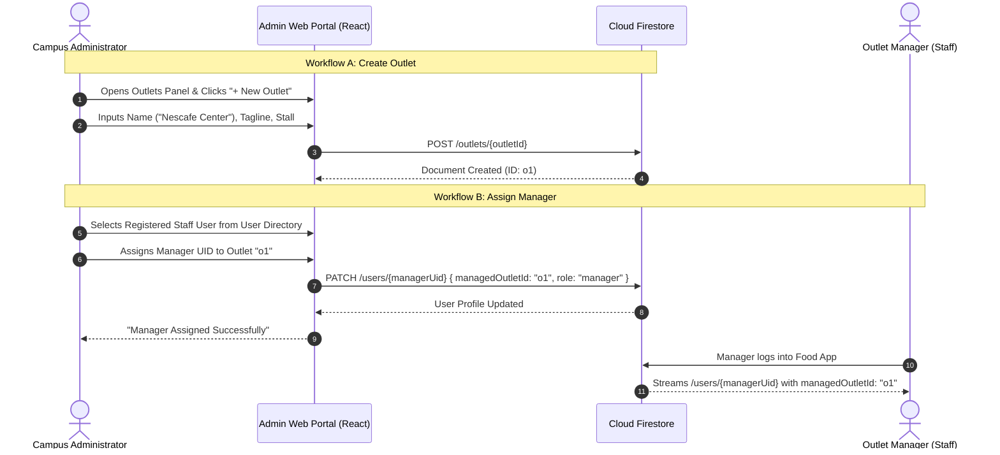
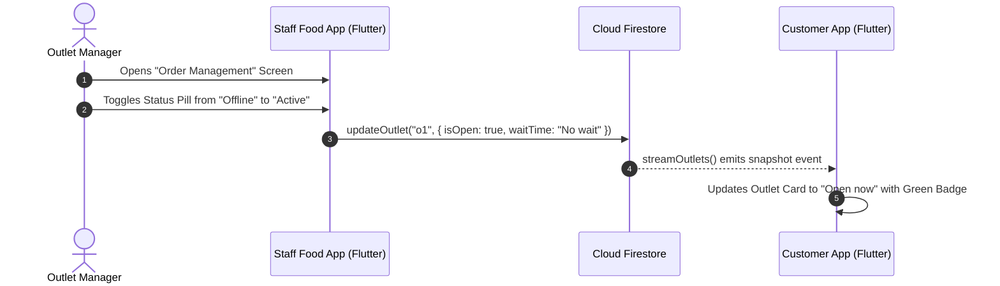
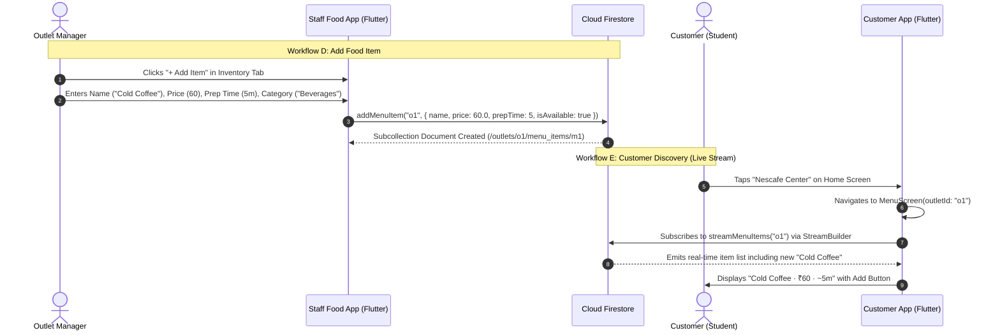
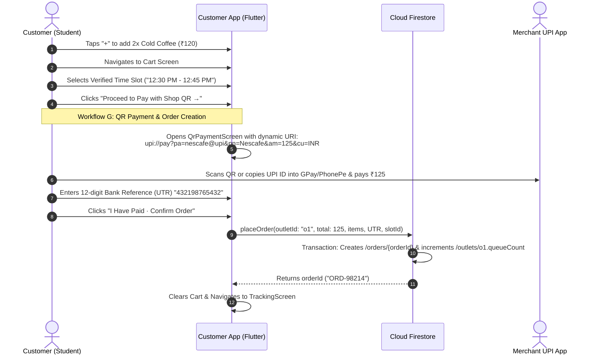
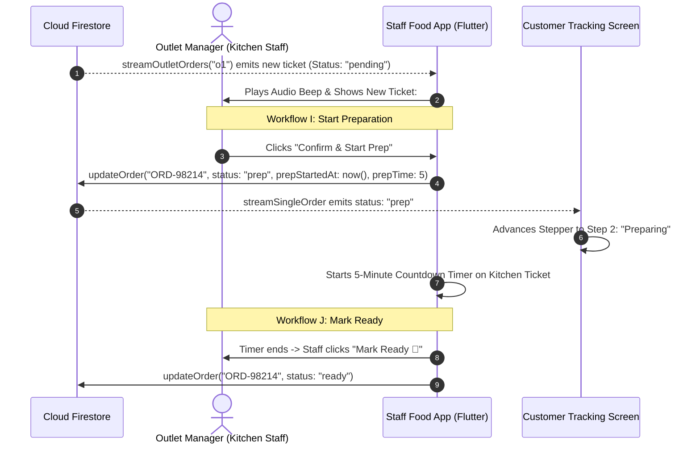
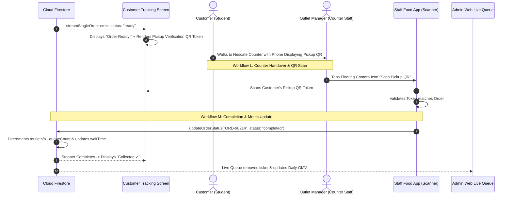

# 🔄 AuraBake — End-to-End Data Flow Diagrams & Architecture Specifications

**Document Version:** 1.0.0  
**Target:** Engineering Architecture & Operational Data Workflows (A through M)  
**System:** AuraBake Campus Food Pre-Ordering System

---

## Architecture Overview
The AuraBake ecosystem connects three decoupled user interfaces through a unified Google Cloud / Firebase Serverless backend:
1. **Customer Mobile Client (Flutter):** Student and faculty ordering, payments, and tracking.
2. **Manager Mobile Client (Flutter):** Kitchen order dispatch, prep timers, and menu availability management.
3. **Administrator Web Portal (React/Vite):** Campus-wide oversight, stall creation, and queue monitoring.

Below are the comprehensive sequence diagrams and data definitions for Workflows **A through M**, explicitly highlighting **[EXISTING WORKING]** vs. **[PROPOSED / TO-BE-IMPLEMENTED]** flows.

---

### Workflow A & B: Admin Creates Outlet & Assigns Manager

> **Status:** **[PROPOSED]** (Currently outlets are manually seeded via `seed.js` or auto-created with errors during manager registration).

---

### Workflow C: Manager Opens Outlet & Configures Information

> **Status:** **[EXISTING PARTIALLY WORKING]** (Shift toggle works; operating hours and UPI configuration are proposed).

---

### Workflow D & E: Manager Adds Food Item & Customer Discovers It

> **Status:** **[CRITICAL ARCHITECTURAL FIX REQUIRED]**  
> *Existing Bug:* Manager adds item to `/outlets/{id}/menu_items`, but `CustomerHome` does not listen to subcollections, and `MenuScreen` consumes a static parameter.  
> *Proposed Flow Below Solves This:*

---

### Workflow F & G: Cart, Slot Selection, Shop QR Payment & Order Placement

> **Status:** **[EXISTING WORKING WITH SHOP UPI QR; SLOTS PROPOSED FOR PRODUCTION]**

---

### Workflow H, I & J: Kitchen Receipt, Preparation & Prep Timer

> **Status:** **[EXISTING WORKING]**

---

### Workflow K, L & M: Ready Status, Pickup Verification QR & Order Completion

> **Status:** **[PROPOSED SECURE HANDOVER PROTOCOL]**  
> *Existing:* Customer sees celebration text; staff taps button without verification.  
> *Proposed Flow Below Introduces Fraud-Proof Handover:*

---

## Data Synchronization Contract Table

| Entity | Canonical Firestore Path | Writers | Listeners / Consumers | Real-Time Mechanism |
| :--- | :--- | :--- | :--- | :--- |
| **User Profile** | `/users/{uid}` | Self (non-restricted fields), Admin | Self (`UserProvider`), Admin (`UserDirectory`) | `snapshots()` on document |
| **Outlet Meta** | `/outlets/{outletId}` | Admin, Assigned Manager | Customers (`CustomerHome`), Admin (`Overview`) | `snapshots()` on collection |
| **Menu Catalog** | `/outlets/{outletId}/menu_items/{itemId}` | Assigned Manager, Admin | Customers (`MenuScreen`), Admin (`MenuManagement`) | `snapshots()` on subcollection |
| **Order Document**| `/orders/{orderId}` | Cloud Function (`placeOrder`) / Customer | Customer (`TrackingScreen`), Staff (`BakerQueueScreen`), Admin (`LiveQueue`) | `snapshots()` with compound query filter |
| **Time Slot** | `/time_slots/{slotId}` | Cloud Function (`placeOrder`), Admin | Customer (`CartScreen`), Admin (`SlotManager`) | `runTransaction()` locking |
| **Support Report**| `/support_reports/{reportId}` | Customer | Admin | Direct write with `serverTimestamp()` |
