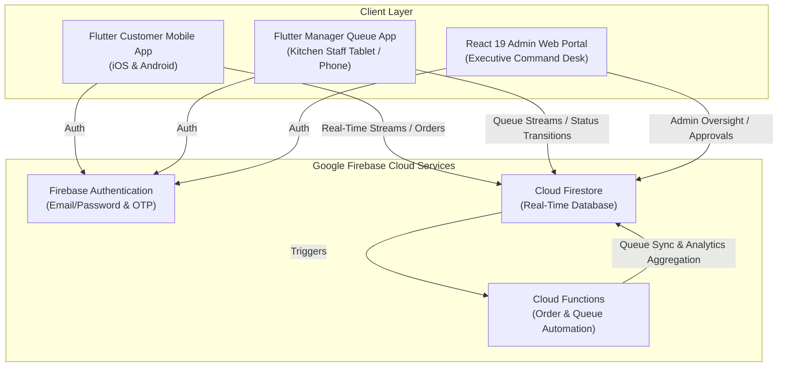

# 🥐 AuraBake — Campus Pre-Order & Kitchen Dispatch System

[](https://github.com/Nav-0019/PreOrderSystem/actions/workflows/ci.yml)
[](https://flutter.dev)
[](https://react.dev)
[](https://www.typescriptlang.org)
[](https://firebase.google.com)

**AuraBake** is a real-time, time-slot based food pre-ordering and kitchen dispatch platform built for campus canteens and food outlets. It eliminates physical queues, balances kitchen preparation loads across peak rush windows, and offers verified contact-free pickup for campus students.

---

## 🏛️ System Architecture



---

## 👥 User Roles & Capabilities

| Capability | 🧑 Student / Customer | 👨‍🍳 Outlet Manager / Baker | 🛠️ Administrator |
|---|:---:|:---:|:---:|
| **Authentication** | Firebase Auth (Student) | Firebase Auth (`baker`, `staff`) | Firebase Auth (`admin`) |
| **Browse Outlets & Menus** | ✅ Live availability | ✅ Own outlet items | ✅ Cross-campus catalog |
| **Time-Slot Reservation** | ✅ Dynamic interval choice | ❌ | ✅ Slot capacity controls |
| **Place Orders & Payment** | ✅ UPI QR + UTR entry | ❌ | ❌ |
| **Order Cancellation** | ✅ When pending only | ❌ | ✅ Emergency Order Doctor |
| **Order Preparation Workflow**| ❌ | ✅ Advance (`pending` → `prep` → `ready`) | ✅ Full status override |
| **Pickup Handover Verification** | 📱 Generates Pickup QR & 4-digit token | 🔍 Requires token verification & quality check | 🔍 Diagnostics & Dispute logging |
| **Menu Item Proposals** | ❌ | 📝 Submits approval tickets | ⚖️ Approve / Reject desk |
| **Queue & Capacity Sync** | ❌ Read-only wait times | ⚡ Live shift controls | 🛠️ One-click sync tools |
| **Dispute & Support Reports** | 📩 Submit issue tickets | ❌ | ⚖️ Issue refunds / close |

---

## 📁 Repository Structure

```
├── .github/
│   └── workflows/ci.yml         # Automated GitHub Actions CI workflow
├── client/
│   ├── food_app/                 # Flutter Mobile App (Customer & Manager)
│   │   ├── lib/
│   │   │   ├── models/           # Data models (MenuItem, Outlet, AppData)
│   │   │   ├── providers/        # State management (CartProvider, UserProvider)
│   │   │   ├── screens/
│   │   │   │   ├── auth/         # Login & Registration screens
│   │   │   │   ├── customer/     # Home, Menu, Cart, QR Payment, Tracking, Support
│   │   │   │   └── staff/        # Baker queue, shift metrics, inventory, profile
│   │   │   ├── services/         # FirebaseService (Firestore transactions & streams)
│   │   │   └── theme/            # AuraBake design system & color palettes
│   │   └── test/                 # Flutter unit & widget tests
│   └── admin_web/                # React 19 / TypeScript / Vite Admin Portal
│       └── src/
│           ├── components/       # Layouts, navigation capsules & error boundaries
│           ├── pages/            # Overview, Approvals, LiveQueue, Menu, Analytics, SettingsHub
│           └── lib/              # Firebase Web SDK initialization
├── firebase/
│   ├── firestore.rules           # Outlet-scoped security rules & validation
│   ├── firestore.indexes.json    # Composite indexes for high-throughput queries
│   ├── firebase.json             # Firebase configuration & emulator settings
│   ├── seed.js                   # Canonical database seed script
│   └── functions/                # Firebase Cloud Functions source
│       ├── package.json          # Node.js 18 dependencies
│       └── index.js              # Triggers, payment verification & queue recalculation
└── docs/                         # Additional project specifications & diagrams
```

---

## 🚀 Getting Started

### Prerequisites
- **Flutter SDK:** `>= 3.11.5`
- **Node.js:** `>= 18.0.0`
- **npm:** `>= 9.0.0`
- **Firebase CLI:** `npm install -g firebase-tools`

---

### 1. Flutter Mobile App (`client/food_app`)

```bash
cd client/food_app

# 1. Install dependencies
flutter pub get

# 2. Run unit and widget test suite
flutter test

# 3. Analyze code health
flutter analyze

# 4. Run application on connected device or emulator
flutter run
```

---

### 2. Admin Web Command Desk (`client/admin_web`)

```bash
cd client/admin_web

# 1. Install dependencies
npm install

# 2. Start local development server with Hot Module Replacement (HMR)
npm run dev

# 3. Build optimized production bundle
npm run build
```

---

### 3. Firebase Backend & Security Rules (`firebase`)

```bash
cd firebase

# 1. Start local Firebase Emulators (Auth, Firestore, Functions)
firebase emulators:start

# 2. Seed initial campus outlets and canonical menu catalog
node seed.js

# 3. Deploy Firestore rules and Cloud Functions to production
firebase deploy --only firestore:rules,functions
```

---

## 🔒 Security Architecture & Access Control

1. **Outlet Isolation (Least Privilege):**
   - Outlet managers and kitchen staff are strictly restricted to their assigned outlet (`managedOutletId`). They cannot read or modify orders, menu items, or settings belonging to another campus stall.
2. **Atomic Orders & Queue Management:**
   - Order placement executes inside a transactional batch (`_db.runTransaction`) that validates stock, persists the selected pickup slot, and atomically increments the outlet queue counter.
3. **Verified Pickup Handover:**
   - Orders in `ready` state generate a dynamic pickup QR code and a 4-digit token on the student's phone. Handover requires kitchen staff to verify the token, preventing duplicate or stolen pickups.
4. **Payment Integrity:**
   - Student payments record UTR transaction references and enter as `PENDING_VERIFICATION` rather than self-authorized `PAID` status, enabling counter staff or automated reconciliation to confirm payments.
5. **Zero Client Secrets:**
   - No administrative passwords, private keys, or API tokens are hard-coded in client bundles.

---

## 📜 Historical / Legacy Artifacts Clarification

Earlier development iterations of AuraBake explored relational database prototypes (FastAPI and PostgreSQL / Supabase). The repository preserves historical reference files (`supabase_schema.sql`, `seed_data.sql`, `live_queue_trigger.sql`, `on_auth_user_created.sql`) for academic audit tracking. **The operational production system uses Google Firebase Cloud Firestore and Cloud Functions.**
